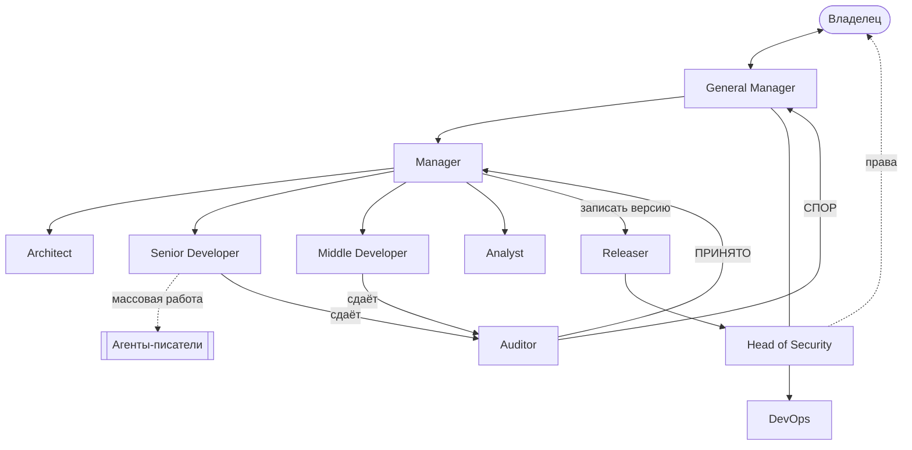

# AI Team Kit для Claude Code

Готовый набор, чтобы запустить в своём проекте команду из нескольких сессий [Claude Code](https://claude.com/claude-code): General Manager, Manager, два разработчика, Architect, Auditor, Head of Security, DevOps, Analyst, Releaser и три уровня агентов-писателей.

Каждая роль — отдельная постоянная сессия в приложении Claude. Вы общаетесь только с General Manager: он ведёт план, раздаёт работу через Manager и раз в час присылает отчёт. Каждую задачу принимает отдельный проверяющий, а опасные действия (git, удаление, интернет) идут через Head of Security.

Как устроен процесс целиком — в [team/PLAYBOOK.md](team/PLAYBOOK.md).

## Назначение

Набор рассчитан на проекты, которые идут дольше одной сессии Claude Code. На таких проектах у одной сессии растёт контекст, ранние решения теряются, а проверяет работу тот же агент, что её сделал. Набор распределяет работу между несколькими сессиями с отдельными ролями и задаёт правила их взаимодействия.

Что это даёт:

- **Участие владельца.** Владелец общается с одной сессией — General Manager — и раз в час получает отчёт: что сделано, что в работе, что нужно от владельца. Следующую задачу General Manager выдаёт по будильнику, без участия владельца.
- **Расход токенов.** Основной расход — пробуждения сессий: каждое входящее сообщение заставляет сессию перечитать свой разговор. Поэтому сообщения отправляются только с задачей, возвратом, вопросом или проблемой, а подтверждения пишутся в журнал. Модели распределены по сложности работы: Opus — для разработки ядра, архитектуры, приёмки и безопасности, Sonnet и Haiku — для рутины. Массовую однотипную работу выполняют одноразовые агенты-писатели, а не постоянные сессии.
- **Размер контекста.** У каждой роли узкая зона ответственности. Роли, которые часто получают задачи, после каждой принятой задачи пишут памятку на 3–5 строк и очищают разговор.
- **Хранение знаний.** Описания ролей, навыки, план, журналы и решения по безопасности хранятся в файлах проекта. Сессию можно очистить или заменить: новая читает файлы и продолжает работу.
- **Проверка.** Каждую задачу принимает отдельная роль: она проверяет данные и код сама, а не по отчёту исполнителя. Возвратов не больше двух, дальше вопрос решает General Manager.
- **Безопасность.** Права, удаление, выход в интернет и записи в git проходят через Head of Security. Опасные действия выполняются через обёртки с фиксированной командой, удаление — только в Корзину, секреты маскируются в истории разговоров.
- **Порядок работы.** В работе одна задача, код пишет один разработчик за раз, у задачи один ответственный и один проверяющий.

## Как устроена команда



Вкратце: вы ставите цели General Manager, он превращает их в план. Manager раздаёт задачи из плана по одной. Исполнитель сдаёт работу проверяющему, и тот сам, по данным, принимает её или возвращает. Принятую задачу Releaser записывает в git, и Manager выдаёт следующую. Всё, что касается прав, удаления и интернета, проходит через Head of Security.

### Роли

| Роль | Что делает | Кому пишет при проблеме |
|---|---|---|
| **General Manager** | Ваш единственный собеседник. Ведёт план и порядок задач, решает споры, раз в час присылает отчёт. Сам задачи не исполняет | Вам |
| **Manager** | Выдаёт задачи по плану по одной, ведёт статусы и журнал передач, следит, чтобы одновременно работал один разработчик | General Manager |
| **Architect** | Пишет описание задачи для разработчика: что строим, правила, краевые случаи, критерии приёмки. Кода не пишет | Manager |
| **Senior Developer** | Сложный код: новые модули, ядро, миграции. Для массовой работы запускает агентов-писателей | Manager; права — DevOps |
| **Middle Developer** | Простой код: запуск готового, переносы, однотипные правки по описанию | Manager; права — DevOps |
| **Auditor** | Принимает каждую задачу: сам проверяет данные и код, а не верит отчёту. Вердикт ПРИНЯТО, ВОЗВРАТ или (после двух возвратов) СПОР | ВОЗВРАТ — исполнителю, ПРИНЯТО — Manager, СПОР — General Manager |
| **Analyst** | Сверяет тексты и результаты с исходными данными, готовит вопросы владельцу (только с разрешения GM) | Manager |
| **Head of Security** | Права, обёртки для опасных команд, проверка нового кода и агентов, выход в интернет, решения об удалении | General Manager; права — вам |
| **DevOps** | Рутина безопасности: контрольные суммы, бэкапы, чистка и установка по уже одобренному | Head of Security |
| **Releaser** | После каждой принятой задачи записывает версию в локальный git | Head of Security |
| **Агенты-писатели** | writer-senior, writer, writer-junior — одноразовые агенты для массовой однотипной работы, без своих сессий | Разработчику, который запустил |

Проверяющий всегда не слабее проверяемого: Opus стоит там, где ошибка дорого стоит, а рутина идёт на Sonnet и Haiku. Модели и усилие для каждой роли — в [team/AGENTS-ROSTER.md](team/AGENTS-ROSTER.md), подробные описания — в [team/roles/](team/roles/).

## Что нужно

- **Приложение Claude, вкладка Code.** В нём есть сообщения между сессиями, смена модели сессии и будильники — без них команда не работает. В терминальном Claude Code этого нет.
- **Локальный git в вашем проекте** (`git init`). Никуда публиковать его не нужно.
- `sh` и `python3` — есть на macOS и Linux из коробки.

## Быстрый старт

```bash
git clone https://github.com/arkonelizarov/ai-team-kit.git
```

```bash
sh ai-team-kit/install.sh /путь/к/вашему/проекту
```

Установщик кладёт навыки в `.claude/skills/`, агентов-писателей в `.claude/agents/`, папки `team/`, `prompts/`, `tools/` — в корень проекта, и добавляет `team/history/` и `.env` в `.gitignore`. Существующие файлы и папки не перезаписывает, так что запускать повторно безопасно.

Дальше:

1. В приложении Claude создайте 10 сессий в папке проекта и назовите их ровно так: **General Manager, Manager, Senior Developer, Middle Developer, Architect, Auditor, Head of Security, DevOps, Analyst, Releaser.**
2. В сессию General Manager вставьте текст из [prompts/bootstrap-general-manager.md](prompts/bootstrap-general-manager.md). Он сам найдёт остальные сессии, поставит им модели, разошлёт вводные, заведёт будильники и спросит у вас первые задачи.
3. **Права.** Чтобы роли не стояли на окнах разрешений, выберите режим разрешений в настройках приложения. Опасные действия лучше завернуть в обёртки с фиксированной командой — их готовит Head of Security вместе с вами (логика — в навыке `sec-review`).

## Состав

| Путь | Что |
|---|---|
| [team/PLAYBOOK.md](team/PLAYBOOK.md) | Как устроен процесс: роли, цикл задачи, эскалация, экономия токенов, безопасность |
| [team/roles/](team/roles/) | Описания 10 ролей: за что отвечает, чего не делает, кому пишет |
| [claude/skills/](claude/skills/) → `.claude/skills/` | Навык (методика) на каждую роль |
| [claude/agents/](claude/agents/) → `.claude/agents/` | Писатели: writer-senior (Opus), writer (Sonnet), writer-junior (Haiku) |
| [team/PLAN.md](team/PLAN.md), [JOURNAL.md](team/JOURNAL.md), [TEAM-DIRECTORY.md](team/TEAM-DIRECTORY.md), [AGENTS-ROSTER.md](team/AGENTS-ROSTER.md), [SECURITY-DECISIONS.md](team/SECURITY-DECISIONS.md) | Шаблоны плана, журналов и справочников |
| [team/outbox/](team/outbox/), [team/memos/](team/memos/) | Исходящие на время паузы рассылки; памятки ролей перед очисткой разговора |
| [prompts/](prompts/) | Первое сообщение General Manager и вводное для ролей |
| [tools/session_history.py](tools/session_history.py) | История разговоров ролей в читаемом виде, с маской секретов |
| [install.sh](install.sh) | Установщик в проект |

## Как подстроить под себя

- **Роли.** Лишние удалите из `team/roles/` и `.claude/skills/`, а также из `team/TEAM-DIRECTORY.md` и `team/AGENTS-ROSTER.md`. Новые добавляйте по образцу существующих — или попросите General Manager.
- **Модели и усилие** — в `team/AGENTS-ROSTER.md`. Правило: проверяющий не слабее того, кого проверяет; рутина — на Sonnet или Haiku.
- **Агенты-писатели** заточены под тексты со ссылками на источники. Для другой массовой работы поправьте их описание в `.claude/agents/`.

## История разговоров

```bash
python3 tools/session_history.py
```

Запускать из папки проекта. Скрипт собирает журналы всех сессий проекта из `~/.claude/projects/` в `team/history/<роль>/` и маскирует ключи, токены, пароли, номера карт, IP, значения из `.env` и строки из `tools/redact-hashes.txt` (туда пишутся sha256 строк, а не сами значения). Если `.env` есть, но не читается, скрипт останавливается, а не собирает историю без маски.

## Участие

Проект открыт для доработок: нашли, что роль работает не так, придумали правило лучше или новую роль — откройте [issue](https://github.com/arkonelizarov/ai-team-kit/issues) или pull request. Как это сделать — в [CONTRIBUTING.md](CONTRIBUTING.md).

## Лицензия

Без ограничений: проект передан в общественное достояние ([Unlicense](LICENSE)). Используйте, меняйте, продавайте, встраивайте куда угодно — без указания автора и без каких-либо условий.
